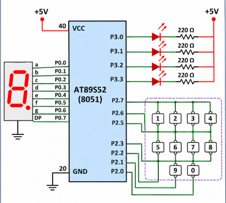

# **README**

# 8051 – HMI Using Matrix Keypad, LEDs and Seven-Segment Display

## Experiment Overview

This experiment implements a Human-Machine Interface (HMI) using an 8051 microcontroller. A matrix keypad is used as the input device, a seven-segment display provides visual feedback, and four LEDs indicate different operating modes.

Whenever a valid key is pressed:
1. The pressed key value is displayed on the seven-segment display.
2. The corresponding LED operation is executed.

The system uses separate functions for keypad scanning, seven-segment display control, and LED operations to ensure modularity and code reusability.

---

## Hardware Requirements

- 8051 Microcontroller (AT89S52)
- 4×4 Matrix Keypad
- 4 LEDs
- Current-limiting resistors
- Seven-Segment Display
- Connecting wires
- 5V Power Supply
- 8051 Development Board

---

## Functional Requirements

The system supports ten different key operations.

| Key Press | Seven-Segment Display | LED Operation |
|:---:|:---:|---|
| 1 | 1 | LED1 ON |
| 2 | 2 | LED2 ON |
| 3 | 3 | LED3 ON |
| 4 | 4 | LED4 ON |
| 5 | 5 | Running LED Pattern |
| 6 | 6 | Alternate LEDs (1010 ↔ 0101) |
| 7 | 7 | Binary Counter (0–15) |
| 8 | 8 | All LEDs Blink |
| 9 | 9 | All LEDs OFF |
| 0 | 0 | Reset System |

---



## TASK 1 – Matrix Keypad Interfacing

### Objective
To interface a matrix keypad with the 8051 microcontroller and detect the pressed key.

### Working Principle

The matrix keypad consists of rows and columns. The microcontroller scans the keypad by activating rows and checking the corresponding column inputs.

When a key is pressed, the row and column combination is identified, and the corresponding key value is returned.

The detected key is passed to the display and LED control functions.

### Key Operations
- Scan the keypad continuously.
- Detect a valid key press.
- Identify the corresponding key value.
- Pass the key value to the main control logic.

---

## TASK 2 – Seven-Segment Display

### Objective
To display the pressed keypad value on a seven-segment display.

### Working Principle

Whenever a valid key is detected, the corresponding digit is sent to the seven-segment display.

The display provides immediate visual feedback about the pressed key.

### Expected Output

| Key Pressed | Display Output |
|:---:|:---:|
| 1 | 1 |
| 2 | 2 |
| 3 | 3 |
| 4 | 4 |
| 5 | 5 |
| 6 | 6 |
| 7 | 7 |
| 8 | 8 |
| 9 | 9 |
| 0 | 0 |

---

## TASK 3 – LED Control Operations

### Objective
To control four LEDs based on the key pressed on the matrix keypad.

### 3.1 Individual LED Control (Keys 1–4)

Each key controls one corresponding LED.

- Key 1: LED1 ON
- Key 2: LED2 ON
- Key 3: LED3 ON
- Key 4: LED4 ON

### 3.2 Running LED Pattern (Key 5)

When key 5 is pressed, the four LEDs turn ON sequentially.

**Expected Pattern:**

```text
LED1 → LED2 → LED3 → LED4 → Repeat
```

### 3.3 Alternating LED Pattern (Key 6)

When key 6 is pressed, the LEDs display two alternating binary patterns.

**Expected Output:**

```text
1010
0101
1010
0101
...
```

### 3.4 Binary Counter (Key 7)

When key 7 is pressed, the four LEDs display a 4-bit binary counting sequence from 0 to 15.

**Expected Output:**

```text
0000
0001
0010
0011
0100
0101
0110
0111
1000
1001
1010
1011
1100
1101
1110
1111
Repeat
```

### 3.5 All LED Blink (Key 8)

When key 8 is pressed, all four LEDs blink simultaneously.

**Expected Output:**

```text
1111
0000
1111
0000
...
```

### 3.6 All LEDs OFF (Key 9)

When key 9 is pressed, all four LEDs are switched OFF.

**Expected Output:**

```text
0000
```

### 3.7 System Reset (Key 0)

When key 0 is pressed, the system returns to its initial state and resets the LED operation.

---

## Program Structure

The program shall consist of separate functions for modular implementation.

| Function | Description |
|---|---|
| `keypad_scan()` | Scans the matrix keypad and identifies the pressed key. |
| `display_digit(unsigned char value)` | Displays the given digit on the seven-segment display. |
| `led_control(unsigned char key)` | Executes the LED operation corresponding to the pressed key. |
| `running_led()` | Implements the sequential running LED pattern. |
| `binary_counter()` | Displays binary values from 0 to 15 using four LEDs. |
| `alternate_led()` | Generates the alternating LED patterns 1010 and 0101. |

---

## Program Execution Flow

1. Initialize the microcontroller GPIO ports.
2. Configure the keypad rows and columns.
3. Initialize the seven-segment display.
4. Configure the four LED pins as outputs.
5. Continuously scan the matrix keypad.
6. Detect a valid key press.
7. Display the corresponding key value on the seven-segment display.
8. Call `led_control()` with the detected key.
9. Execute the corresponding LED operation.
10. Continue scanning for the next key press.

---

## Concepts Covered

- 8051 GPIO programming.
- Matrix keypad interfacing.
- Row-column scanning technique.
- Seven-segment display interfacing.
- LED interfacing and control.
- Binary counting and bit manipulation.
- Sequential and alternating LED patterns.
- Modular programming using functions.
- Software delay generation.
- Embedded C programming.

---

## Expected Result

Successfully implement an HMI system using the 8051 microcontroller, matrix keypad, seven-segment display, and four LEDs.

The system detects keypad inputs, displays the corresponding key value, and performs the assigned LED operation based on the pressed key.

---

## Software Requirements

- Keil µVision IDE
- 8051 C Compiler
- Embedded C

## Hardware Platform

- AT89S52 Microcontroller
- 8051 Development Board

---

## Deliverables

- Complete Embedded C source code.
- Hardware connection details.
- Circuit diagram.
- README documentation.
- GitHub repository containing the implementation.
