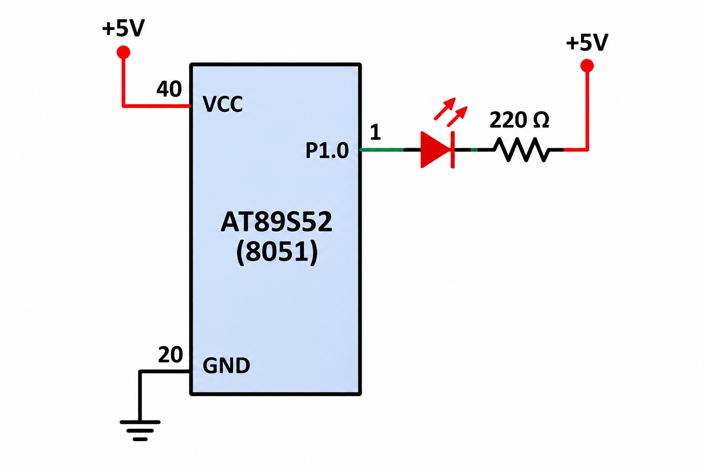

# **README**

# 8051 – Timer Interrupt Based PWM and Signal Generation

## Experiment Details

**Experiment:** Software PWM Generation and Signal Generation Using Timer Interrupts

**Microcontroller:** 8051 (AT89S52)

**Development Environment:** Keil µVision

**Crystal Frequency:** 11.0592 MHz

---


## TASK 3 – Software PWM and LED Fading

### 1. Objective

To generate a software-based PWM (Pulse Width Modulation) signal using the Timer 0 interrupt developed in Task 1.

The duty cycle is gradually varied from 0% to 100% and then back to 0%, producing a visible LED fading effect.

Additionally, configure a GPIO pin as an output and generate square-wave signals of different frequencies using timer interrupts.

---

### 2. Working Principle

Pulse Width Modulation (PWM) is a technique used to control the average power delivered to a device by varying the ON and OFF durations of a digital signal.

The PWM signal consists of two important parameters:

- **Frequency:** Number of complete ON-OFF cycles per second.
- **Duty Cycle:** Percentage of time the signal remains HIGH during one complete cycle.

The Timer 0 interrupt is used as the time base for generating the PWM signal.

The software continuously updates the duty cycle, gradually increasing it from 0% to 100% and then decreasing it back to 0%.

This produces a smooth LED fading effect.

### 3. Duty Cycle Variation

The duty cycle is varied in steps of 10%.

**Expected Sequence:**

```text
0% → 10% → 20% → 30% → 40%
   → 50% → 60% → 70% → 80%
   → 90% → 100%
   → 90% → 80% → ... → 10% → 0%
```

### 4. Duty Cycle and LED Brightness

| Duty Cycle | LED Brightness |
|:---:|---|
| 0% | OFF |
| 25% | Dim |
| 50% | Medium |
| 75% | Bright |
| 100% | Fully ON |

### 5. Suggested PWM Frequency

The recommended PWM frequency is:

**500 Hz – 1 kHz**

At this frequency, the LED should appear continuously illuminated rather than visibly flickering.

### 6. Implementation Steps

1. Configure Timer 0 using the interrupt configuration developed in Task 1.
2. Configure a GPIO pin as an output for LED control.
3. Generate a periodic timer interrupt.
4. Implement software PWM using a counter.
5. Compare the PWM counter with the selected duty cycle.
6. Set the GPIO output HIGH when the counter is within the ON period.
7. Set the GPIO output LOW during the OFF period.
8. Gradually increase the duty cycle from 0% to 100%.
9. Gradually decrease the duty cycle from 100% to 0%.
10. Repeat the process continuously to produce the LED fading effect.

---

## TASK 3 – Square Wave Generation at Different Frequencies

### 1. Objective

To configure a GPIO pin as a signal output and use timer interrupts to generate square-wave signals of different frequencies.

The output frequency and duty cycle are measured using an oscilloscope.

### 2. Working Principle

A square wave is a digital signal that alternates between HIGH and LOW states.

The Timer 0 interrupt is used to control the timing of GPIO state transitions.

Whenever the required timer interval is reached, the GPIO output is toggled.

By varying the timer interval, square waves of different frequencies can be generated.

### 3. Frequency Modes

The experiment requires generating five different output frequencies.

| Mode | Output Frequency |
|:---:|:---:|
| Mode 1 | 100 Hz |
| Mode 2 | 500 Hz |
| Mode 3 | 1 kHz |
| Mode 4 | 2 kHz |
| Mode 5 | 5 kHz |

### 4. Implementation Steps

1. Configure the required GPIO pin as an output.
2. Configure Timer 0 to generate periodic interrupts.
3. Initialize the output pin to LOW.
4. Toggle the GPIO pin inside the timer interrupt routine.
5. Adjust the timer interval to generate the required output frequency.
6. Implement five frequency modes.
7. Measure the output waveform using an oscilloscope.
8. Verify the generated frequency and duty cycle.

### 5. Oscilloscope Verification

Connect the oscilloscope probe to the configured GPIO output pin.

Verify the following parameters:

- Output frequency.
- Signal time period.
- HIGH duration.
- LOW duration.
- Duty cycle.

For a 50% duty-cycle square wave:

```text
       HIGH        LOW
    ┌────────┐
    │        │
────┘        └────────┐
                      │
                      └────

    One complete cycle
```

---

## TASK 4 – Different Signal Types

### Objective

To generate different digital signal patterns using the timer interrupt mechanism after successfully implementing square-wave generation.

### 1. Square Wave

A square wave alternates continuously between HIGH and LOW states with equal ON and OFF durations.

**Example:**

```text
101010101010
```

### 2. Variable Duty-Cycle Wave

A variable duty-cycle wave is generated by changing the HIGH and LOW durations of the signal.

This demonstrates how the duty cycle affects the waveform.

**Example:**

```text
1111000011110000
```

### 3. Pulse Train

A pulse train consists of a sequence of pulses separated by LOW intervals.

**Example:**

```text
100000001000000010000000
```

### 4. Burst Signal

A burst signal consists of a group of pulses followed by a period of inactivity, after which another group of pulses is generated.

**Example:**

```text
1010101010 0000000000 1010101010
```

---

## Concepts Covered

- Timer 0 configuration and interrupts.
- Software-based PWM generation.
- Pulse Width Modulation.
- Duty-cycle calculation.
- LED brightness control.
- LED fading effect.
- GPIO output configuration.
- Square-wave generation.
- Frequency and time-period calculation.
- Variable duty-cycle signals.
- Pulse train generation.
- Burst signal generation.
- Oscilloscope-based waveform verification.

---

## Expected Results

1. Successfully generate a software PWM signal using Timer 0 interrupts.
2. Gradually vary the PWM duty cycle from 0% to 100% and back to 0%.
3. Produce a visible LED fading effect.
4. Generate square-wave signals at 100 Hz, 500 Hz, 1 kHz, 2 kHz and 5 kHz.
5. Generate different signal types, including square waves, variable duty-cycle waves, pulse trains and burst signals.
6. Verify the output frequency and duty cycle using an oscilloscope.

---

## Hardware Requirements

- 8051 Microcontroller (AT89S52)
- LED
- Current-limiting resistor
- 11.0592 MHz Crystal Oscillator
- 8051 Development Board
- Digital Oscilloscope
- Connecting Wires
- 5V Power Supply

## Software Requirements

- Keil µVision IDE
- 8051 C Compiler
- Embedded C

---

## Deliverables

- Complete Embedded C source code.
- Timer interrupt configuration.
- Software PWM implementation.
- LED fading implementation.
- Square-wave generation for all five frequency modes.
- Different signal waveform implementations.
- Oscilloscope output measurements.
- README documentation.
- GitHub repository containing the implementation.

---

## Result

Successfully implemented software PWM generation using Timer 0 interrupts to control LED brightness through gradual duty-cycle variation.

Also generated square waves at different frequencies and implemented multiple digital signal patterns, including square waves, variable duty-cycle waves, pulse trains and burst signals. Verified the generated waveforms using an oscilloscope.
