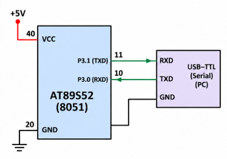

# TASK B – UART Character Reception

## 1. Objective

To implement UART character reception and receive data transmitted from a PC terminal using the 8051 microcontroller.

## 2. Working Principle

The UART receiver continuously monitors incoming serial data through the RXD pin.

When a character is received:

1. The RI flag indicates that reception is complete.
2. The received character is read from the SBUF register.
3. The RI flag is cleared.
4. The received character can be processed or transmitted back to the PC.

This enables bidirectional serial communication between the microcontroller and the PC terminal.

## 3. Expected Behaviour

- Type a character in PuTTY.
- The character is transmitted to the 8051 through the USB-to-TTL converter.
- The 8051 receives the character through its RXD pin.
- The received character can be processed or echoed back to PuTTY.

---
