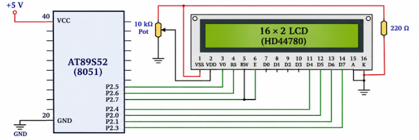

# **README**

# 8051 – UART Echo and Serial Communication

## Experiment Details

**Experiment:** UART Echo Using 8051 Microcontroller

**Microcontroller:** AT89S52 (8051)

**Development Environment:** Keil µVision

**Communication Interface:** UART

**Serial Terminal:** PuTTY

**Baud Rate:** 9600

**Communication Format:** 9600-8-N-1

**Crystal Frequency:** 11.0592 MHz

---


## 1. Problem Statement

Develop an interactive UART-based communication system using the 8051 microcontroller.

The system must receive characters transmitted from a PC terminal through a USB-to-TTL serial interface and immediately transmit the same characters back to the PC.

Whenever a character is typed in PuTTY, the 8051 must receive and return the character.

### Expected Behaviour

If the user types:

```text
ABC123
```

The terminal should display:

```text
ABC123
```

The communication follows the sequence:

```text
PC → 8051 → PC
```

---

# TASK B – UART Echo

## STAGE 1 – Identify UART Pins

### Objective

To identify the serial communication pins of the AT89S52 microcontroller.

### Working Principle

The AT89S52 provides two dedicated UART communication signals through alternate functions of Port 3.

| Pin | Alternate Function | Description |
|---|---|---|
| P3.0 | RXD | Serial Data Reception |
| P3.1 | TXD | Serial Data Transmission |

These pins are used for asynchronous serial communication.

- **RXD:** Receives serial data from the PC.
- **TXD:** Transmits serial data to the PC.

### Hardware Connections

| 8051 Development Board | USB-to-TTL Converter |
|---|---|
| P3.1 (TXD) | RXD |
| P3.0 (RXD) | TXD |
| GND | GND |

The USB-to-TTL converter is connected to the PC through a USB port.

---

## STAGE 2 – UART Configuration Register

### Objective

To understand and configure the UART operating mode using the SCON register.

### SCON – Serial Control Register

The SCON register controls the UART operating mode, reception enable and serial communication flags.

For the AT89S52, SCON is an 8-bit register.

### SCON Register Configuration

| Bit | Name | Function |
|---|---|---|
| SCON.7 | SM0 | Serial Mode Selection |
| SCON.6 | SM1 | Serial Mode Selection |
| SCON.5 | SM2 | Multiprocessor Communication |
| SCON.4 | REN | Receiver Enable |
| SCON.3 | TB8 | Transmit Bit 8 |
| SCON.2 | RB8 | Receive Bit 8 |
| SCON.1 | TI | Transmit Interrupt Flag |
| SCON.0 | RI | Receive Interrupt Flag |

### UART Mode Selection

The UART supports multiple operating modes.

For this experiment, Mode 1 is selected.

| SM0 | SM1 | UART Mode | Description |
|---|---|---|---|
| 0 | 0 | Mode 0 | Shift Register |
| 0 | 1 | Mode 1 | 8-bit UART |
| 1 | 0 | Mode 2 | 9-bit UART |
| 1 | 1 | Mode 3 | 9-bit UART |

### Mode 1 Configuration

- 8-bit data transmission.
- Asynchronous serial communication.
- One start bit.
- One stop bit.
- Variable baud rate.

The SCON register is configured as:

```c
SCON = 0x50;
```

This enables UART Mode 1 and reception.

---

## STAGE 3 – UART Data Register (SBUF)

### Objective

To understand how the 8051 transmits and receives serial data using the SBUF register.

### SBUF – Serial Buffer Register

SBUF is the serial data buffer register used for both transmission and reception.

**Transmission:**

When the microcontroller wants to transmit a character, the character is written into SBUF.

```c
SBUF = 'A';
```

**Reception:**

When a character is received, it is available in SBUF.

```c
received_char = SBUF;
```

The SBUF register is used for both transmitting and receiving characters.

---

## STAGE 4 – Understand How Transmission Completes

### Objective

To understand how the microcontroller identifies the completion of serial transmission.

### TI – Transmit Interrupt Flag

The TI flag is set by hardware when the transmission of a character is completed.

The software checks this flag to determine whether the transmitted character has finished.

### Transmission Sequence

1. Write the character into SBUF.
2. The UART begins serial transmission.
3. The character is transmitted through TXD.
4. After transmission is completed, the TI flag is set.
5. Software detects TI = 1.
6. Clear the TI flag before transmitting the next character.

### Transmission Logic

```c
SBUF = 'A';

while(TI == 0);

TI = 0;
```

### Transmission Flow

```text
Character to Transmit
         |
         v
    Write to SBUF
         |
         v
   UART Transmission
         |
         v
       TXD Pin
         |
         v
   Transmission Complete
         |
         v
       TI = 1
         |
         v
      Clear TI
```

---

## STAGE 5 – Baud Rate Generation

### Objective

To understand how the baud rate is generated for UART communication using the 8051 microcontroller.

### Working Principle

Both the transmitting and receiving devices must operate at the same baud rate for successful serial communication.

The 8051 commonly uses Timer 1 in Mode 2 (8-bit auto-reload mode) to generate the UART baud rate.

### Timer 1 Configuration

- Timer: Timer 1
- Mode: Mode 2
- Operation: 8-bit auto-reload
- Baud-rate generation: Timer overflow

### Why Mode 2?

Timer 1 Mode 2 automatically reloads the timer with the value stored in TH1 whenever an overflow occurs.

This provides a consistent timer overflow rate, making it suitable for UART baud-rate generation.

---

## STAGE 6 – Derive 9600 Baud

### Objective

To calculate the Timer 1 reload value required to generate a baud rate of 9600.

### Given

- Crystal Frequency = 11.0592 MHz
- Required Baud Rate = 9600
- UART Mode = Mode 1
- Timer 1 Mode = Mode 2
- SMOD = 0

### Baud Rate Formula

For UART Mode 1 using Timer 1 Mode 2:

```text
Baud Rate = (2^SMOD / 32) × Timer 1 Overflow Rate
```

Timer 1 overflow rate:

```text
Overflow Rate = (Oscillator Frequency / 12)
                / (256 - TH1)
```

Therefore:

```text
Baud Rate = (2^SMOD / 32)
            × [Fosc / (12 × (256 - TH1))]
```

Substituting SMOD = 0:

```text
9600 = 11.0592 MHz / [384 × (256 - TH1)]
```

Solving:

```text
256 - TH1 = 3

TH1 = 256 - 3

TH1 = 253

TH1 = FDH
```

### Final Timer Configuration

| Parameter | Value |
|---|---|
| Crystal Frequency | 11.0592 MHz |
| Required Baud Rate | 9600 |
| Timer | Timer 1 |
| Timer Mode | Mode 2 |
| SMOD | 0 |
| TH1 | FDH |
| TL1 | FDH |
| Baud Rate | 9600 |

---

## STAGE 7 – UART Initialization

### Objective

To develop a `uart_init()` function that configures the 8051 UART for 9600-8-N-1 communication.

### Implementation

The UART initialization function performs the following operations:

1. Configure Timer 1 in Mode 2.
2. Load the baud-rate reload value into TH1.
3. Initialize TL1.
4. Configure UART Mode 1 using SCON.
5. Enable serial reception.
6. Start Timer 1.

### UART Initialization Code

```c
void uart_init(void)
{
    TMOD = (TMOD & 0x0F) | 0x20;

    TH1 = 0xFD;
    TL1 = 0xFD;

    SCON = 0x50;

    TR1 = 1;
}
```

---

## STAGE 8 – First Verification

### Objective

To verify that the UART configuration is working correctly before implementing the complete communication application.

### Verification Procedure

1. Connect the 8051 development board to the PC using a USB-to-TTL converter.
2. Identify the assigned COM port.
3. Open PuTTY.
4. Select Serial connection.
5. Configure the baud rate to 9600.
6. Set data bits to 8.
7. Set parity to None.
8. Set stop bits to 1.
9. Verify the UART communication using a simple transmission test.

### PuTTY Configuration

| Parameter | Value |
|---|---|
| Connection Type | Serial |
| Serial Line | Assigned COM Port |
| Speed | 9600 |
| Data Bits | 8 |
| Stop Bits | 1 |
| Parity | None |
| Flow Control | None |

---

## STAGE 9 – Receive a Character

### Objective

To understand how the 8051 receives a character transmitted from the PC.

### Working Principle

The UART receiver continuously monitors incoming serial data through the RXD pin.

When a complete character is received, the hardware sets the RI (Receive Interrupt) flag.

The software checks RI to determine whether a character has arrived.

The received character is then read from SBUF.

### RI – Receive Interrupt Flag

- RI = 1 indicates that a character has been received.
- The received character is available in SBUF.
- The software reads SBUF.
- RI must be cleared before the next reception.

### Reception Code

```c
unsigned char received_char;

while(RI == 0);

received_char = SBUF;

RI = 0;
```

### Reception Sequence

```text
Character Sent from PC
          |
          v
         RXD
          |
          v
   UART Reception
          |
          v
        RI = 1
          |
          v
   Read Character
       from SBUF
          |
          v
       Clear RI
```

---

## STAGE 10 – PuTTY Echo Experiment

### Objective

To develop an application that continuously receives one character from PuTTY and immediately transmits the same character back to the PC.

### Working Principle

The 8051 continuously checks for incoming characters from the PC.

When a character is received:

1. The RI flag is checked.
2. The received character is read from SBUF.
3. The RI flag is cleared.
4. The received character is written back to SBUF.
5. The TI flag is checked to confirm transmission completion.
6. The TI flag is cleared.

This process repeats continuously.

### UART Echo Code

```c
#include <REG51.H>

void uart_init(void)
{
    TMOD = (TMOD & 0x0F) | 0x20;

    TH1 = 0xFD;
    TL1 = 0xFD;

    SCON = 0x50;

    TR1 = 1;
}

void uart_transmit(unsigned char ch)
{
    SBUF = ch;

    while(TI == 0);

    TI = 0;
}

unsigned char uart_receive(void)
{
    unsigned char ch;

    while(RI == 0);

    ch = SBUF;

    RI = 0;

    return ch;
}

void main(void)
{
    unsigned char received_char;

    uart_init();

    while(1)
    {
        received_char = uart_receive();

        uart_transmit(received_char);
    }
}
```

### Expected Output

**Input typed in PuTTY:**

```text
Hello 8051
```

**Output received from 8051:**

```text
Hello 8051
```

The same character is returned immediately to the PC.

### Communication Flow

```text
       PC / PuTTY
            |
            | Character
            v
       USB-to-TTL
            |
            v
      8051 RXD (P3.0)
            |
            v
      UART Reception
            |
            v
         SBUF
            |
            v
      UART Processing
            |
            v
      UART Transmission
            |
            v
      8051 TXD (P3.1)
            |
            v
       USB-to-TTL
            |
            v
       PC / PuTTY
```

---

## Concepts Covered

- 8051 UART architecture.
- UART TXD and RXD pins.
- SCON register configuration.
- UART Mode 1 operation.
- SBUF register.
- Serial transmission and reception.
- TI and RI flag handling.
- Baud-rate generation.
- Timer 1 Mode 2 configuration.
- Baud-rate calculation.
- 9600-8-N-1 serial communication.
- USB-to-TTL interfacing.
- Character echo implementation.
- Serial debugging using PuTTY.

---

## Hardware Requirements

- AT89S52 Microcontroller
- 8051 Development Board
- USB-to-TTL Serial Converter
- USB Cable
- Connecting Wires
- PC or Laptop

## Software Requirements

- Keil µVision IDE
- 8051 C Compiler
- PuTTY Serial Terminal
- Embedded C

---

## Expected Results

1. Identify the UART TXD and RXD pins of the AT89S52.
2. Configure the UART in Mode 1.
3. Configure Timer 1 in Mode 2 for baud-rate generation.
4. Calculate and configure the reload value for 9600 baud.
5. Successfully initialize the UART.
6. Receive characters transmitted from PuTTY.
7. Transmit the received characters back to the PC.
8. Verify successful UART echo communication.

---

## Result

Successfully configured UART communication on the AT89S52 microcontroller for 9600-8-N-1 operation using Timer 1 Mode 2.

Implemented character reception and transmission using the SBUF register and RI/TI flags. Successfully established bidirectional serial communication between the 8051 microcontroller and PuTTY through a USB-to-TTL interface, implementing a UART echo application.
