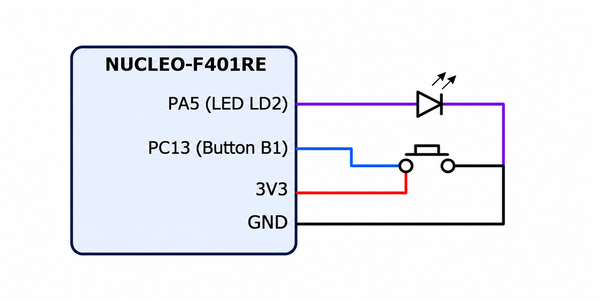

# **README**

# STM32 – On-board LED Bring-Up

## Experiment Details

**Experiment:** On-board LED Bring-Up

**Microcontroller:** STM32F401RE

**Development Board:** NUCLEO-F401RE

**Development Environment:** STM32CubeIDE

**Programming Language:** Embedded C

---
## Circuit Diagram



## TASK 12A – On-board LED Bring-Up

### 1. Objective

To develop and program an STM32 application to verify the NUCLEO-F401RE hardware and GPIO output configuration by blinking the on-board LED at a fixed time interval.

The experiment focuses on initializing the microcontroller GPIO peripheral, configuring the LED pin as an output, and generating periodic ON and OFF transitions.

### 2. Working Principle

The on-board LED is controlled through a GPIO output pin of the STM32 microcontroller.

The GPIO pin is configured as an output using the appropriate GPIO configuration settings.

The program continuously toggles the GPIO output state with a fixed time delay between transitions.

- When the GPIO output is HIGH, the LED turns ON.
- When the GPIO output is LOW, the LED turns OFF.

This process repeats continuously, producing a blinking effect.

### 3. Implementation Steps

1. Create a new STM32 project for the NUCLEO-F401RE development board.
2. Configure the system clock.
3. Identify the GPIO pin connected to the on-board LED.
4. Enable the corresponding GPIO peripheral clock.
5. Configure the LED GPIO pin as an output.
6. Initialize the GPIO configuration.
7. Set the LED output to HIGH.
8. Introduce a fixed delay.
9. Set the LED output to LOW.
10. Introduce another fixed delay.
11. Repeat the process continuously.

### 4. Expected LED Behaviour

The on-board LED should blink continuously at a fixed interval.

**Expected Sequence:**

```text
Time       LED State

0 sec      ON
1 sec      OFF
2 sec      ON
3 sec      OFF
4 sec      ON
5 sec      OFF
...
```

### 5. Expected Output

- Successful initialization of the NUCLEO-F401RE board.
- Correct GPIO output configuration.
- On-board LED turns ON and OFF periodically.
- Continuous LED blinking at a fixed interval.

### 6. Concepts Covered

- STM32 microcontroller initialization.
- NUCLEO-F401RE hardware bring-up.
- GPIO peripheral configuration.
- GPIO output control.
- Digital HIGH and LOW states.
- Software delay generation.
- Embedded C programming.
- STM32CubeIDE project development.

### 7. Result

Successfully developed and programmed an STM32 application to verify the NUCLEO-F401RE hardware and GPIO output configuration.

The on-board LED blinks continuously at a fixed interval, confirming successful GPIO initialization and output control.

---

## Hardware Requirements

- NUCLEO-F401RE Development Board
- USB Cable
- PC or Laptop

## Software Requirements

- STM32CubeIDE
- STM32 HAL Library (if HAL-based implementation is used)
- Embedded C

---

## Deliverables

- STM32 project configuration.
- GPIO output configuration.
- On-board LED blinking implementation.
- Complete Embedded C source code.
- README documentation.
- GitHub repository containing the implementation.
