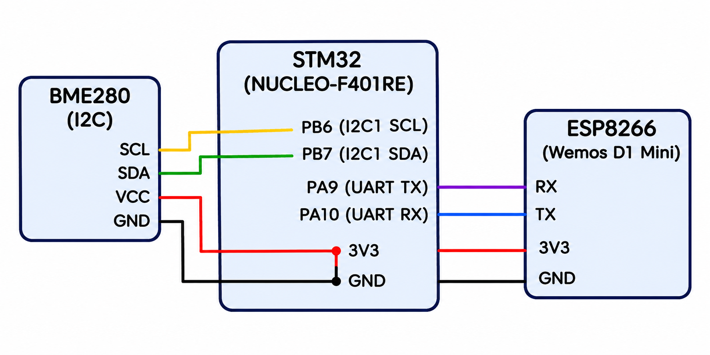

# **README**

# Sensor Interfacing (BME280) – MQTT – Node Analytics

## Experiment Details

**Experiment:** BME280 Sensor Interfacing Using I2C and MQTT

**Microcontroller:** STM32F410RB

**Sensor:** Bosch BME280

**Communication Protocol (Sensor):** I2C

**Wi-Fi Module:** Wemos D1 Mini (ESP8266)

**Communication Protocol (Network):** MQTT

**Development Environment:** STM32CubeIDE / Keil µVision

**Sensor Driver:** Bosch Sensortec BME280 Sensor API

**Wi-Fi and MQTT Driver:** Custom-Built ESP8266 API

**Analytics Platform:** Node-RED

---
## Circuit Diagram


## 1. Problem Statement

As a continuation of the previous exercise, develop an STM32-based environmental sensing application to interface a BME280 sensor using the I2C protocol and obtain compensated temperature, pressure, and humidity measurements.

The acquired environmental measurements must be transmitted to Node-RED for analytics using the MQTT protocol.

Use the included custom-built ESP8266 library for enabling MQTT communication.

---

## 2. Objective

To develop an environmental monitoring system using STM32F410RB, BME280, and Wemos ESP8266.

The system should:

- Interface the BME280 sensor with STM32 using I2C.
- Obtain compensated temperature, pressure, and humidity measurements.
- Establish UART communication between STM32 and ESP8266.
- Implement MQTT communication using the custom-built ESP8266 API.
- Publish environmental sensor data to an MQTT broker.
- Receive and visualize the published data using Node-RED.

---

## 3. Hardware Requirements

- STM32F410RB Development Board
- Bosch BME280 Environmental Sensor
- Wemos D1 Mini (ESP8266)
- Connecting Wires
- Appropriate Power Supply
- PC or Laptop

---

## 4. Software Requirements

- STM32CubeIDE
- Keil µVision (if used)
- STM32 HAL Library
- Bosch Sensortec BME280 Sensor API
- Custom-Built ESP8266 Library
- MQTT Broker
- MQTTX (for testing, if required)
- Node-RED

---

## 5. BME280 Sensor Interfacing Using I2C

### Objective

To establish I2C communication between the STM32F410RB and the BME280 sensor and retrieve environmental measurements.

### Working Principle

The STM32 acts as the I2C master, while the BME280 operates as the I2C slave.

The microcontroller communicates with the sensor through the SDA and SCL lines.

The Bosch Sensortec BME280 Sensor API is integrated into the STM32 project to initialize the sensor, configure its operating parameters, and retrieve compensated measurement values.

### Implementation Steps

1. Configure the I2C peripheral in STM32CubeIDE.
2. Establish I2C communication with the BME280 sensor.
3. Integrate the Bosch Sensortec BME280 Sensor API.
4. Implement the required I2C read and write functions.
5. Initialize the BME280 sensor.
6. Configure the sensor settings.
7. Retrieve temperature, pressure, and humidity measurements.
8. Obtain compensated sensor values using the Bosch API.
9. Verify the acquired measurements through the debugging interface.

---

## 6. Bosch Sensortec BME280 Sensor API

### Objective

To use the official Bosch driver implementation for sensor initialization, configuration, data acquisition, and compensation.

### Important API Functions

| Function | Purpose |
|---|---|
| `bme280_init()` | Initialize the BME280 device |
| `bme280_set_sensor_settings()` | Configure sensor settings |
| `bme280_set_sensor_mode()` | Configure sensor operating mode |
| `bme280_get_sensor_data()` | Retrieve compensated sensor measurements |

### Official Repository

https://github.com/boschsensortec/BME280_SensorAPI

The API provides:
- Sensor initialization.
- Register read and write operations.
- Calibration data handling.
- Compensation algorithms.
- Temperature measurement.
- Pressure measurement.
- Humidity measurement.

---

## 7. ESP8266 Integration Using Custom-Built API

### Objective

To establish communication between STM32 and Wemos ESP8266 using UART and enable MQTT functionality through the custom-built ESP8266 library.

### Working Principle

The STM32 communicates with the Wemos ESP8266 through UART.

The custom-built ESP8266 API is used to implement the Wi-Fi and MQTT communication functionality.

The ESP8266 connects to the available Wi-Fi network and establishes communication with an MQTT broker.

The environmental measurements acquired from the BME280 are transferred from STM32 to ESP8266 and published to the configured MQTT topic.

### Implementation Steps

1. Configure UART communication between STM32 and Wemos.
2. Integrate the custom-built ESP8266 library.
3. Initialize the ESP8266 communication interface.
4. Configure Wi-Fi credentials.
5. Establish Wi-Fi connectivity.
6. Configure the MQTT broker connection.
7. Establish an MQTT connection.
8. Configure the MQTT topic for publishing sensor data.
9. Transfer the acquired sensor measurements to ESP8266.
10. Publish the measurements to the MQTT broker.

---

## 8. MQTT Communication

### Objective

To transmit environmental sensor measurements from the STM32-based system to an MQTT broker using the ESP8266.

### Working Principle

MQTT is a lightweight messaging protocol based on the publish-subscribe communication model.

The ESP8266 acts as an MQTT client and publishes the environmental measurements to a specified topic.

The MQTT broker receives the published messages and distributes them to subscribed clients.

Node-RED subscribes to the configured topic and receives the sensor data for further processing and visualization.

### MQTT Communication Flow

```text
       BME280 SENSOR
              |
              | I2C
              v
        STM32F410RB
              |
              | UART
              v
        Wemos ESP8266
              |
              | MQTT Publish
              v
         MQTT Broker
              |
              | MQTT Subscribe
              v
           Node-RED
              |
              v
      Analytics Dashboard
```

### MQTT Data Parameters

The system publishes the following environmental parameters:

| Parameter | Description | Unit |
|---|---|---|
| Temperature | Ambient temperature | °C |
| Pressure | Atmospheric pressure | hPa |
| Humidity | Relative humidity | % RH |

### Implementation Steps

1. Connect the ESP8266 to the Wi-Fi network.
2. Configure the MQTT broker address and port.
3. Initialize the MQTT client using the custom ESP8266 API.
4. Establish a connection with the MQTT broker.
5. Configure the MQTT publishing topic.
6. Acquire environmental measurements from the BME280.
7. Prepare the sensor data for transmission.
8. Publish temperature, pressure, and humidity values.
9. Verify successful publication using an MQTT client or broker interface.

---

## 9. Node-RED Analytics

### Objective

To receive and visualize environmental sensor measurements published through MQTT.

### Working Principle

Node-RED subscribes to the MQTT topic used by the ESP8266 for publishing sensor data.

Whenever a new message is received, Node-RED processes the incoming data and updates the corresponding dashboard elements.

The dashboard provides a visual representation of the environmental parameters.

### Implementation Steps

1. Open the Node-RED editor.
2. Configure an MQTT broker connection.
3. Add an MQTT input node.
4. Configure the topic to match the ESP8266 publishing topic.
5. Receive the incoming MQTT messages.
6. Process the received sensor data.
7. Extract temperature, pressure, and humidity values.
8. Connect the processed data to dashboard visualization nodes.
9. Display the environmental measurements.
10. Verify that the dashboard updates when new MQTT messages arrive.

### Expected Dashboard Parameters

| Dashboard Element | Sensor Parameter |
|---|---|
| Temperature Display | Temperature (°C) |
| Pressure Display | Pressure (hPa) |
| Humidity Display | Humidity (% RH) |

---

## 10. Overall Implementation Workflow

```text
      BME280 INITIALIZATION
                |
                v
       I2C COMMUNICATION
                |
                v
     SENSOR DATA ACQUISITION
                |
                v
     COMPENSATED MEASUREMENTS
                |
                v
         STM32F410RB
                |
                | UART
                v
         WEMOS ESP8266
                |
                v
         WIFI CONNECTION
                |
                v
        MQTT INITIALIZATION
                |
                v
        MQTT BROKER
                |
                v
          NODE-RED
                |
                v
       DATA VISUALIZATION
```

---

## 11. Expected Results

1. Successfully establish I2C communication between STM32 and BME280.
2. Integrate the Bosch Sensortec BME280 Sensor API.
3. Initialize and configure the environmental sensor.
4. Retrieve compensated temperature measurements.
5. Retrieve compensated pressure measurements.
6. Retrieve compensated humidity measurements.
7. Establish UART communication between STM32 and ESP8266.
8. Integrate the custom-built ESP8266 API.
9. Establish Wi-Fi connectivity.
10. Connect the ESP8266 to the MQTT broker.
11. Publish environmental measurements to the MQTT topic.
12. Subscribe to the MQTT topic using Node-RED.
13. Visualize real-time environmental sensor data on the dashboard.

---

## 12. Concepts Covered

- STM32 microcontroller programming.
- I2C communication protocol.
- BME280 sensor interfacing.
- Bosch Sensortec Sensor API.
- Sensor calibration and compensation.
- Temperature, pressure, and humidity acquisition.
- UART communication.
- ESP8266 Wi-Fi connectivity.
- Custom-built embedded libraries.
- MQTT publish-subscribe architecture.
- MQTT broker configuration.
- MQTT topic management.
- Node-RED MQTT integration.
- Real-time environmental data visualization.
- Embedded IoT system development.

---

## 13. Result

Successfully developed an STM32-based environmental sensing application using the BME280 sensor and Bosch Sensortec Sensor API.

Established I2C communication to acquire compensated temperature, pressure, and humidity measurements.

Integrated the custom-built ESP8266 library to enable Wi-Fi and MQTT communication. Published the acquired environmental measurements to an MQTT broker and received the data in Node-RED for analytics and visualization.

---

## Deliverables

- STM32 I2C configuration.
- Bosch BME280 Sensor API integration.
- BME280 sensor initialization and configuration.
- Temperature, pressure, and humidity acquisition.
- UART communication implementation.
- Custom-built ESP8266 API integration.
- Wi-Fi connectivity implementation.
- MQTT broker connection.
- MQTT sensor data publishing.
- Node-RED MQTT subscription.
- Environmental analytics dashboard.
- Complete Embedded C source code.
- README documentation.
- GitHub repository containing the implementation.
