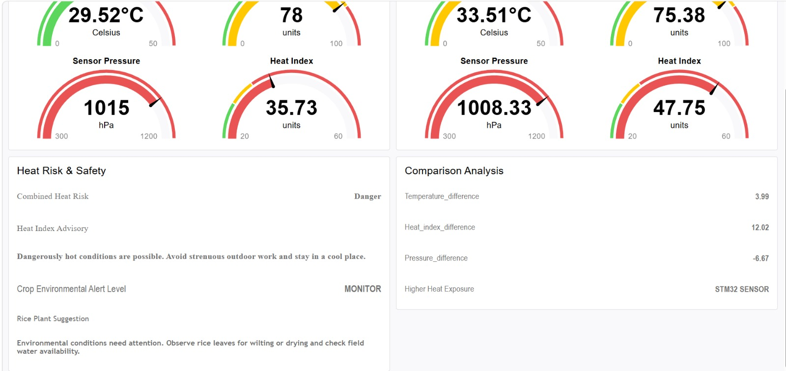

# PROJECT REPORT

# IoT-Based Smart Environmental Monitoring and Agricultural Analytics System

**Technologies:** STM32, BME280, ESP8266, HTTP, MQTT, Node-RED

---
## Project Image



## 1. ABSTRACT

Environmental monitoring plays an important role in agriculture, particularly in understanding temperature, atmospheric pressure, humidity, and heat-related conditions that influence crop growth.

This project presents an IoT-based Smart Environmental Monitoring and Agricultural Analytics System that combines HTTP and MQTT communication to collect, transmit, analyze, and visualize environmental sensor data.

The system uses an STM32F410RB microcontroller interfaced with a Bosch BME280 environmental sensor through the I2C protocol. The BME280 provides compensated temperature, pressure, and humidity measurements using the Bosch Sensortec Sensor API. A Wemos D1 Mini (ESP8266) provides Wi-Fi connectivity and enables communication with the server using HTTP and MQTT protocols.

The collected environmental data is integrated into a Node-RED dashboard, where measurements from two sensor sources are displayed and compared. In addition to real-time monitoring, the system incorporates heat index analysis, combined heat-risk assessment, environmental alerts, and agricultural recommendations specifically oriented towards rice cultivation.

The proposed system demonstrates how embedded systems, wireless communication protocols, and IoT analytics can be integrated to develop an intelligent environmental monitoring solution for agricultural applications.

---

## 2. INTRODUCTION

Environmental conditions significantly influence agricultural productivity. Parameters such as temperature, humidity, and atmospheric pressure provide useful information about the surrounding environment and can help identify potentially unfavorable conditions for crops.

Traditional environmental monitoring systems often require manual observation and periodic data collection. Such approaches make continuous monitoring and timely identification of environmental changes difficult.

The proposed system addresses this limitation by integrating sensor interfacing, wireless communication, and real-time analytics.

The project combines two communication approaches:

- **HTTP Communication:** Used to transmit environmental information through HTTP requests and receive server responses.
- **MQTT Communication:** Used to publish environmental sensor data to an MQTT broker and deliver it to Node-RED subscribers.

The collected information is processed and displayed through a centralized Node-RED dashboard. The dashboard provides comparative sensor readings, heat index calculations, environmental risk classification, and agricultural suggestions.

---

## 3. OBJECTIVES

The primary objectives of this project are:

1. Interface the BME280 environmental sensor with the STM32 microcontroller using I2C communication.
2. Obtain compensated temperature, atmospheric pressure, and humidity measurements.
3. Establish UART communication between STM32 and ESP8266.
4. Implement Wi-Fi connectivity using the ESP8266 module.
5. Implement HTTP-based communication for environmental data transfer.
6. Implement MQTT-based communication using a custom-built ESP8266 API.
7. Integrate HTTP and MQTT data streams into Node-RED.
8. Develop a real-time environmental monitoring dashboard.
9. Compare environmental measurements obtained from two sensor sources.
10. Calculate and display heat index and environmental differences.
11. Generate heat-risk alerts and agricultural recommendations based on environmental conditions.

---

## 4. SYSTEM ARCHITECTURE

The system consists of four major layers.

### 4.1 Sensor Layer

The sensor layer is responsible for collecting environmental measurements.

The Bosch BME280 sensor measures:

- Temperature
- Atmospheric pressure
- Relative humidity

The sensor communicates with the STM32 through the I2C protocol.

### 4.2 Embedded Processing Layer

The STM32F410RB acts as the main processing unit.

Its responsibilities include:

- Initializing the BME280 sensor.
- Configuring I2C communication.
- Acquiring environmental measurements.
- Processing compensated sensor values.
- Communicating with the ESP8266 through UART.

### 4.3 Wireless Communication Layer

The Wemos D1 Mini (ESP8266) provides wireless connectivity.

Two communication approaches are incorporated:

**HTTP Communication**

- Establishes a TCP connection with an HTTP server.
- Transmits HTTP GET requests using ESP8266 AT commands.
- Receives HTTP responses.
- Enables communication between the embedded device and server.

**MQTT Communication**

- Uses a custom-built ESP8266 API.
- Establishes Wi-Fi connectivity.
- Connects to an MQTT broker.
- Publishes environmental sensor measurements.
- Enables Node-RED to subscribe to incoming sensor data.

### 4.4 Application and Analytics Layer

Node-RED acts as the application and analytics platform.

It receives environmental information through the communication channels and processes the data to provide:

- Real-time sensor visualization.
- Comparative sensor analysis.
- Heat index monitoring.
- Combined heat-risk assessment.
- Environmental alert classification.
- Rice plant environmental recommendations.

### Overall System Architecture

```text
             BME280 SENSOR
                    |
                    | I2C
                    |
                    v
              STM32F410RB
                    |
                    | UART
                    |
                    v
              WEMOS ESP8266
                    |
              Wi-Fi Connection
                    |
           +--------+--------+
           |                 |
           v                 v
      HTTP SERVER        MQTT BROKER
           |                 |
           |                 |
           v                 v
      HTTP DATA          MQTT DATA
           |                 |
           +--------+--------+
                    |
                    v
                 NODE-RED
                    |
                    v
           DATA PROCESSING
                    |
          +---------+----------+
          |         |          |
          v         v          v
       SENSOR     HEAT       AGRICULTURAL
     COMPARISON   ANALYSIS    RECOMMENDATIONS
          |         |          |
          +---------+----------+
                    |
                    v
             WEB DASHBOARD
```

---

## 5. HARDWARE COMPONENTS

### 5.1 STM32F410RB

The STM32F410RB microcontroller acts as the central embedded processing unit.

It interfaces with the BME280 sensor through I2C and communicates with the ESP8266 through UART.

### 5.2 BME280 Environmental Sensor

The Bosch BME280 is used to measure three environmental parameters.

| Parameter | Measurement Unit |
|---|---|
| Temperature | °C |
| Atmospheric Pressure | hPa |
| Relative Humidity | % RH |

The official Bosch Sensortec
