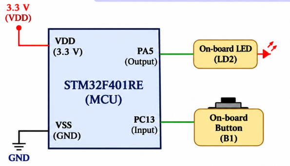

# **README**

# STM32 – GPIO Input/Output (Push Button and LED)

## Experiment Details

**Experiment:** GPIO Input/Output Interfacing

**Microcontroller:** STM32

**Development Board:** NUCLEO-F401RE

**Development Environment:** STM32CubeIDE

**Programming Language:** Embedded C

**Interface:** GPIO

---
## Circuit Diagram

## TASK 8A – GPIO Input/Output

### 1. Objective

To interface a push button and LED with the STM32 microcontroller by configuring the corresponding GPIO pins.

The objective is to develop firmware that allows the LED to follow the state of the push button.

### 2. Working Principle

The push button is configured as a GPIO input, while the LED is configured as a GPIO output.

The STM32 continuously monitors the push-button input and controls the LED according to the detected switch state.

When the button is pressed, the LED turns ON. When the button is released, the LED turns OFF.

The LED output directly follows the state of the push button.

### 3. GPIO Configuration

Two GPIO pins are required for this experiment.

| Component | GPIO Configuration | Function |
|---|---|---|
| Push Button | Input | Detect button state |
| LED | Output | Control LED state |

### 4. Working Logic

1. Initialize the GPIO peripherals.
2. Configure the push-button pin as an input.
3. Configure the LED pin as an output.
4. Continuously read the push-button state.
5. Check whether the button is pressed.
6. If the button is pressed, turn ON the LED.
7. If the button is released, turn OFF the LED.
8. Repeat the process continuously.

### 5. Implementation Steps

1. Create a new STM32 project in STM32CubeIDE.
2. Select the appropriate STM32 development board.
3. Identify the GPIO pin connected to the push button.
4. Identify the GPIO pin connected to the LED.
5. Configure the push-button GPIO as an input.
6. Configure the LED GPIO as an output.
7. Generate the project code.
8. Initialize the GPIO peripherals.
9. Implement continuous push-button state monitoring.
10. Control the LED based on the push-button input.
11. Build and flash the firmware onto the STM32 board.
12. Verify the LED response by pressing and releasing the button.

### 6. Expected Behaviour

| Push Button State | LED State |
|---|---|
| Pressed | ON |
| Released | OFF |

### 7. Expected Output

- Successful GPIO initialization.
- Push-button input detection.
- LED turns ON when the button is pressed.
- LED turns OFF when the button is released.
- LED output continuously follows the switch state.

### 8. Concepts Covered

- STM32 GPIO configuration.
- GPIO input and output modes.
- Push-button interfacing.
- LED interfacing.
- Digital input reading.
- Digital output control.
- Conditional statements.
- Continuous GPIO monitoring.
- Embedded C programming.
- STM32CubeIDE development.

### 9. Result

Successfully interfaced a push button and LED with the STM32 microcontroller using GPIO input/output configuration.

The firmware continuously monitors the push-button state and controls the LED accordingly. The LED turns ON when the button is pressed and turns OFF when the button is released.

---

## Hardware Requirements

- STM32 Development Board (NUCLEO-F401RE)
- On-board or External Push Button
- LED
- Connecting Wires (if using external components)
- USB Cable
- PC or Laptop

## Software Requirements

- STM32CubeIDE
- STM32 HAL Library (if HAL-based implementation is used)
- Embedded C

---

## Deliverables

- GPIO input configuration.
- GPIO output configuration.
- Push-button interfacing implementation.
- LED control implementation.
- Complete Embedded C source code.
- README documentation.
- GitHub repository containing the implementation.
