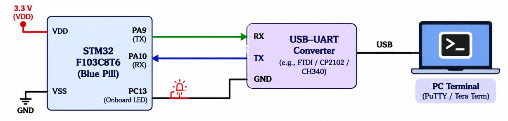

# **README**

# STM32 – Basic UART Communication

## Experiment Details

**Experiment:** Basic UART Communication

**Microcontroller:** STM32

**Development Environment:** STM32CubeIDE

**Configuration Tool:** STM32CubeMX

**Programming Language:** Embedded C

**Communication Interface:** UART

**Serial Terminal:** PuTTY / Tera Term

**Driver:** STM32 HAL Library

---
## Circuit Diagram



## TASK 9A – Basic UART Communication

### 1. Objective

To configure UART communication using STM32CubeMX and HAL libraries, establish serial communication between the STM32 microcontroller and a PC terminal, and implement character and string transmission and reception.

The experiment consists of two main operations:

1. **Transmit a Character:** Configure the STM32 UART peripheral and transmit a character repeatedly to a PC terminal.
2. **Receive and Echo:** Modify the application so that every character received from the PC is transmitted back to the PC.

---

### 2. Working Principle

UART (Universal Asynchronous Receiver/Transmitter) is a serial communication protocol used to exchange data between the STM32 microcontroller and external devices.

The STM32 communicates with the PC through a serial interface using a USB-to-UART connection.

The UART peripheral supports:
- Serial data transmission.
- Serial data reception.
- Asynchronous communication.
- Character-based communication.
- String transmission and reception.

The STM32 HAL library provides functions for configuring and controlling UART communication.

---

### 3. UART Configuration Using STM32CubeMX

### Objective

To configure the UART peripheral using STM32CubeMX.

### Configuration Parameters

| Parameter | Configuration |
|---|---|
| Mode | Asynchronous |
| Baud Rate | As configured in CubeMX |
| Word Length | 8 Bits |
| Stop Bits | 1 |
| Parity | None |
| Hardware Flow Control | None |
| Transmit | Enabled |
| Receive | Enabled |

### Implementation Steps

1. Create a new STM32 project.
2. Open the Pinout & Configuration view.
3. Select the required UART peripheral.
4. Enable asynchronous communication mode.
5. Configure TX and RX pins.
6. Set the baud rate and serial communication parameters.
7. Enable the required GPIO and UART clocks.
8. Generate the initialization code.
9. Initialize the UART peripheral using the HAL library.

---

# TASK 9A.1 – Transmit a Character

### 4. Objective

To configure the STM32 UART peripheral and repeatedly transmit a character to a PC terminal.

### Working Principle

The STM32 transmits a character through its UART TX pin.

The transmitted character is received by the PC through a serial interface and displayed on the terminal.

The transmission process is repeated continuously with a suitable delay between successive transmissions.

### HAL Function Used

```c
HAL_UART_Transmit()
```

**Function Purpose:**

Transmits data through the configured UART peripheral.

### Function Syntax

```c
HAL_UART_Transmit(
    &huart,
    data,
    size,
    timeout
);
```

### Implementation Steps

1. Initialize the UART peripheral.
2. Declare a character variable.
3. Assign the character to be transmitted.
4. Call `HAL_UART_Transmit()` to send the character.
5. Introduce a suitable delay.
6. Repeat the transmission continuously.

### Expected Output

The character should appear repeatedly on the PC terminal.

**Example:**

```text
AAAAAAAAAAAAAAAAAAAA
```

---

# TASK 9A.2 – Receive and Echo

### 5. Objective

To modify the UART application so that every character received from the PC terminal is immediately transmitted back to the PC.

### Working Principle

The STM32 receives characters through its UART RX pin.

Whenever a character is typed in the PC terminal:

1. The UART peripheral receives the character.
2. The STM32 reads the received character.
3. The received character is stored in a variable.
4. The same character is transmitted back using UART.
5. The process repeats continuously.

This creates a UART echo application.

### HAL Functions Used

**1. HAL_UART_Receive()**

Receives data through the configured UART peripheral.

**2. HAL_UART_Transmit()**

Transmits the received data back to the PC terminal.

### Function Syntax

```c
HAL_UART_Receive(
    &huart,
    data,
    size,
    timeout
);
```

```c
HAL_UART_Transmit(
    &huart,
    data,
    size,
    timeout
);
```

### Implementation Steps

1. Initialize the UART peripheral.
2. Declare a variable to store the received character.
3. Wait for a character from the PC terminal.
4. Receive the character using `HAL_UART_Receive()`.
5. Store the received character.
6. Transmit the same character using `HAL_UART_Transmit()`.
7. Repeat the process continuously.

### Expected Behaviour

If the user types:

```text
HELLO STM32
```

The PC terminal should display the echoed characters:

```text
HELLO STM32
```

The same characters transmitted from the PC are returned by the STM32.

---

## 6. Communication Flow

### Character Transmission

```text
       STM32
          |
          | UART TX
          v
      USB-to-UART
          |
          v
      PC Terminal
          |
          v
   Character Display
```

### Character Reception and Echo

```text
      PC Terminal
           |
           | UART TX
           v
       STM32 RX
           |
           v
    Receive Character
           |
           v
    Store Character
           |
           v
     STM32 TX
           |
           v
      PC Terminal
           |
           v
    Display Echoed Data
```

---

## 7. Expected Results

1. Successfully configure UART using STM32CubeMX.
2. Initialize UART communication using STM32 HAL.
3. Transmit a character repeatedly to the PC terminal.
4. Receive characters transmitted from the PC.
5. Echo every received character back to the PC.
6. Verify successful serial communication using PuTTY or Tera Term.

---

## 8. Concepts Covered

- UART communication protocol.
- STM32CubeMX UART configuration.
- STM32 HAL UART functions.
- Asynchronous serial communication.
- UART TX and RX pins.
- Character transmission.
- Character reception.
- String transmission and reception.
- USB-to-UART interfacing.
- Serial debugging using PuTTY.
- Embedded C programming.

---

## 9. Result

Successfully configured UART communication between the STM32 microcontroller and a PC terminal using STM32CubeMX and HAL libraries.

Implemented repeated character transmission and character reception with echo functionality. Verified successful serial communication through the PC terminal.

---

## Hardware Requirements

- STM32 Development Board
- USB-to-UART Interface (if required)
- USB Cable
- PC or Laptop

## Software Requirements

- STM32CubeIDE
- STM32CubeMX
- STM32 HAL Library
- PuTTY / Tera Term
- Embedded C

---

## Deliverables

- STM32 UART configuration.
- UART initialization implementation.
- Character transmission functionality.
- Character reception functionality.
- UART echo implementation.
- Complete Embedded C source code.
- README documentation.
- GitHub repository containing the implementation.
